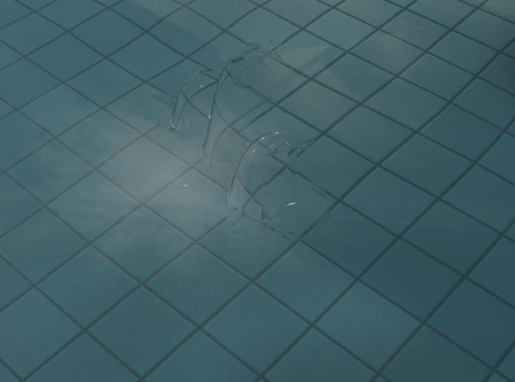
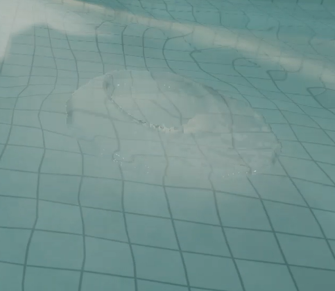
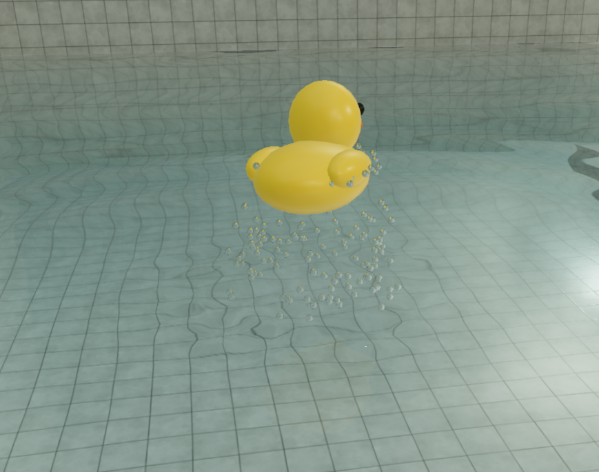

# WebGPU 迁移交接与待修报告

日期：2026-10-04。用户要求停止继续修复，将当前代码推到 GitHub，由朋友接手。

**这是未完成的迁移快照，不是视觉、性能或功能验收完成版。** 最终代码静态检查通过；连贯水片效果、首次冲击卡顿、流式房间和最后的 RT 改动仍需 GPU 验证与修复。

## 项目与启动

- 仓库：<https://github.com/YBZSG/beyond-the-basin>。
- 交接分支：`cde/aged-pool-arcade`。
- 本机路径：`G:\beyond-the-basin`，页面 `/pool-vct`，种子 `250821`。
- `G:\MCC` 只保留 Godot 工程，不要在那里重建 Web 项目或修改 Godot。
- Three.js `0.185.1`；默认使用 WebGPU，浏览器使用 Microsoft Edge。
- 此次只提交、推送交接分支，未合并 main、未部署网站。

```powershell
npm ci
npm run dev -- --port 3000
# Edge 打开 http://localhost:3000/pool-vct?qa=1

npm test
npm run typecheck
npm run lint
npm run build
```

`?qa=1` 在开发或显式 benchmark 构建中提供 `window.__poolQA`。生产构建不提供常规 QA API。页面标签、构建成功和 QA 钩子不能代替真实 GPU 与输入验收。

## 用户要恢复的效果

原话：“砸一个水花就会卡，进一些房间也会卡”“这水花不就是贴图吗”“不止水花啊，原来还会有炸起的连贯的”。

目标是冲击后先掀起**连贯水片**，有弯曲边缘、反射折射，再破裂成小滴并落回水面。不能只恢复小水滴、关闭液体或改为预制水花图片。

用户提供的原效果参考（不是本次代码已达到的结果）：



迁移后用户报告的平薄主体与散落珠子观感：





原实现使用三维 MLS-MPM 粒子加屏幕空间表面重建，不是预制水花图片；表面渲染仍使用深度纹理。代码存在三维模拟不代表原来的连贯视觉效果已经保留。

## 此快照包含的修改

| 文件/模块 | 当前修改 |
| --- | --- |
| `webgpu/shader-material.ts` | 原数值 GLSL 转 TSL/WGSL；discard、嵌套循环、像素/深度坐标适配；液体 PMREM 空值和更新处理 |
| `webgpu/legacy-texture.ts` | 原 GLSL 左下角坐标与 WebGPU 附件左上角坐标统一；归一化采样、texel load、独立 live uniform |
| `webgpu/materials.ts` | 世界坐标瓷砖 UV、法线、湿粗糙度、clearcoat、VCT、焦散接收、门洞点光遮挡；新增飞沫透射和金属 BVH 反射 |
| `webgpu/planar-capture.ts` | 主场景 WebGPU 水面平面反射捕获 |
| `shallow-water.ts` | GPU 异步回读按行翻转，使波位置和 CPU 浮力索引一致 |
| `splash-particles.ts` | WebGPU 获取目标/绘图缓冲大小，避免不存在的 `getCurrentViewport()` |
| `world.ts` | VCT 上一代纹理暂存到下一次重建释放，避免异步探针引用立即被销毁的资源 |
| `engine.ts` | 环境 PMREM atlas 复用；初始探针和部分液体/飞沫加载期预热 |
| `rt.ts`、`bvh-visibility.ts` | 保留 BVH 工作线程；整数纹理格式适配；最后新增整代发布和上一代暂存 |

还包含此前的旧白瓷、低拱廊及湿墙 SSR 修改。此前视觉基线为 `24434fe`，远程 main 基线为 `66a4543`。`docs/aged-pool-validation-2026-10-03.md` 是旧 WebGL 验收，不能证明本次 WebGPU 已完成。

## 交接时的验证状态

| 最终代码检查 | 结果 | 边界 |
| --- | --- | --- |
| `npm test` | 116 passed，0 failed | CPU/结构/工作线程等已有测试 |
| `npm run typecheck` | 通过 | 类型 |
| `npm run lint` | 通过 | 静态规则 |
| `npm run build` | 通过 | 生产构建；有 chunk 大小提示 |
| `git diff --check` | 通过 | 补丁空白格式 |
| 最终 WebGPU 完整交互/视觉回归 | **未完成** | 不能宣称全部正常或不卡 |

此前中间版本的 `tests/pool-webgpu-gpu.mjs` 曾在 Edge 通过五项检查，错误数组为空：

1. 实际 backend 为 `webgpu`。
2. 非对称渐变连续两次 color/depth copy 后方向不变，顶部 green 约 `0.96826`，颜色误差 `0`。
3. 非均匀深度复制顶部约 `0.68408`，深度误差 `0`。
4. 四个起初共用空图的 live VCT binding 切换后分别约 `[0.2,0.4,0.6,0.8]`。
5. 世界 `(2,7)` 注入浅水波，NaN 为 `0`，GPU centroidZ 为 `7`；CPU 同侧有波，镜像 `(2,-7)` 为 `0`，异步回读生效。

这些结果在**最后 RT、预热、BVH 整代发布改动之前**，需要重跑。可移植结果见 [证据 JSON](webgpu-handoff-assets/evidence.json)。

一次无脚本/GPU 错误的中间版本连续点击测试：首次冲击最大帧间隔约 `347 ms`；随后两次中位约 `15 ms`、P95 约 `19–22 ms`。后续受控冲击测到 `3552` 个可见液体粒子、`17` 个飞沫、累计 `86` 次分离，但那轮同时捕获了 RT bind group 错误，只能说明模拟在运行，不能作为最终性能或视觉通过证据。

最后一次新 Edge 页面初始化日志只记录 favicon 404 和 Windows 忽略 `powerPreference` 的提示。尚未对最后代码完整重测砸水、多个房间和质量切换。

## 待修事项

### P0：恢复连贯主体水片

相关：[`liquid-mpm.ts`](../app/pool-vct/liquid-mpm.ts)、[`liquid-surface-pass.ts`](../app/pool-vct/liquid-surface-pass.ts)、[`shader-material.ts`](../app/pool-vct/webgpu/shader-material.ts)、[`legacy-texture.ts`](../app/pool-vct/webgpu/legacy-texture.ts)。

现象：主体体积和连续轮廓弱，像平薄覆盖或散落珠子。尚未证明根因在模拟、过滤、世界高度裁剪还是光学采样；不要直接认定粒子数量不足。

先用相同种子、相机和冲击比较基线与当前版本。逐层查看原始液体深度、过滤深度、重建法线、世界高度和合成；重点检查 `eyePosition()` 的逆投影/Y 方向、`world.y < level` 裁剪、深度遮挡、PMREM 更新/布局及折射采样。

验收：点击和真实道具落水都能看到水片升起、弯曲、破裂、回落；转视角后轮廓、遮挡、反射仍正确。附多个阶段的帧或短视频，不能只截小滴。

### P0：最后的 RT 材质 GPU 回归

相关：[`webgpu/materials.ts`](../app/pool-vct/webgpu/materials.ts)、[`bvh-visibility.ts`](../app/pool-vct/webgpu/bvh-visibility.ts)、[`rt.ts`](../app/pool-vct/rt.ts)。

最近真实日志曾出现：

```text
sampled textures (18) ... exceeds ... maximum ... (16)
poolReflect: expected array<vec3<f32>, 18>, got array<vec4<f32>, 18>
Failed to create texture ... format: RGBA32F, size: 2x2
Invalid BindGroupLayout ... invalid due to a previous error
```

最后已做源码修正：GI/RT 共享四个 VCT 节点；lamp color 接受 TSL 实际生成的 vec4 数组；rtColor 占位图清除 WebGL `internalFormat`。**修改后只完成静态检查和初始化观察，缺完整 GPU 复验。**

验收：无 WGSL、bind group 或纹理错误；chrome/red 反射正确的最近命中和物体颜色；连续换房不读取混合代 BVH。建议用小场景检查最近命中/颜色，并核验目标适配器的纹理绑定上限。

### P1：首次砸水和进房间的卡顿

相关：`engine.ts`、`ripple-detail.ts`、`water-system.ts`、`liquid-mpm.ts`、`liquid-surface-pass.ts`、`splash-particles.ts`。

已加入部分加载期预热，但首次冲击仍曾出现 `350–430 ms` 长帧。分段测首次数值 source shader、液体计算与表面管线、道具阴影、探针。两个浏览器或其他 GPU 负载会影响结果，现有数据不是严格基准。

验收：冷启动第一、第二、连续多次冲击分别记录帧间隔、CPU 阶段和可取得的 GPU 时间；再测步行跨门和菜单跳转。不要用平均 FPS 掩盖长帧，不关闭水花作为修复。

### P1：纹理生命周期、质量切换和流式房间

曾报 `Destroyed texture ... used in a submit`，涉及 VCT 占位图及 `1024x1024 RGBA16Float`。VCT 暂存、PMREM 复用、BVH 整代发布已改，但未证明所有路径都修复。

检查 `VoxelField.begin/finish/dispose`、`ReflectionField.beginRebuild/stepRebuild/invalidate/dispose`、`InteractiveWater.updateQuality`。关注旧浅水/细波资源释放、live uniform 更新、重建取消、快速传送和 GPU 异步引用。

验收：旧泳池、高拱门大厅、连通浴池、跳台高廊、夜间浴场、柱阵水厅和崩坏区往返；Low/Medium/High/Ultra 切换；种子重建和窗口缩放。无脚本、GPU、已销毁纹理、worker 错误，帧循环持续。

### P1：输入、湿墙及水体完整回归

画面方向已修正，鼠标符号没有为了补偿倒置画面而翻转。仍需实际 pointer lock 下鼠标四方向、WASD、投掷、浮力、水波位置、湿墙 SSR 开关对照、焦散/GI、镜头和质量切换。不要只用程序化相机跳转代替输入测试。

`poolFloater` metadata 尚未迁入节点，但搜索未发现活跃调用；先确认是否真实使用，不为闲置路径增加功能。

### P2：整理诊断与兼容边界

`engine.ts` 仍保留开发 QA 的 `renderResources()`，暴露 renderer/scene/composer 等，后续可移除或改为只读诊断。临时 `__poolShaderFailure` 已删除。

GLSL→TSL 桥接及 renderer 节点 cache hook 依赖当前 Three 内部行为。先保留锁文件版本，升级需重跑 GPU 检查。自动 WebGL2 fallback 也是节点渲染器后端，尚无最终完整验收。

## 推荐接手顺序

1. 拉取交接分支、阅读 AGENTS.md、核对源码和 Git 状态，跑四项静态检查。
2. Edge 冷启动，先验证最后的 RT 改动和纹理上传/释放。
3. 复现参考图的连贯液体，逐层定位并恢复水片效果。
4. 测首个冲击和各房间长帧，完善实际会用到的预热和分帧处理。
5. 完成输入、道具、水体、湿墙、质量与流式房间矩阵，再更新验收文档。

GPU 脚本通过 Playwright CLI 执行，必须使用 `--filename`：

```powershell
npx --yes --package @playwright/cli playwright-cli -s=pool-webgpu-qa open "http://localhost:3000/pool-vct?qa=1" --browser=msedge --headed
npx --yes --package @playwright/cli playwright-cli -s=pool-webgpu-qa run-code --filename=tests/pool-webgpu-gpu.mjs
```

`tests/pool-wet-reflections-gpu.mjs`、`tests/pool-water-layers-gpu.mjs` 已保留。先看源码确认对 WebGPU 的覆盖，不能套用旧 WebGL 结论。

## 本机额外资料

`output/webgpu-repair/`、`output/playwright/`、`.playwright-cli/` 被 Git 忽略，朋友只拉仓库不会收到。报告已附用户参考图和关键结果。

- 原始未提交补丁：`output/webgpu-repair/before.patch`。
- 历史 GPU 检查：`gpu-check-v3.txt`。
- 冲击诊断：`splash-runtime-v2.txt`、`splash-runtime-v3.txt`；后者有 RT 错误，不作通过证据。
- 最终检查日志：`handoff-test.txt`、`handoff-typecheck.txt`、`handoff-lint.txt`、`handoff-build.txt`。
- 原错误截图：[viewport 报错](webgpu-handoff-assets/reported-viewport-error.png)。

未继续更换水体实现，未完成全部交互验收。请按待修事项推进，不将此快照描述为已完成的 WebGPU 迁移。
